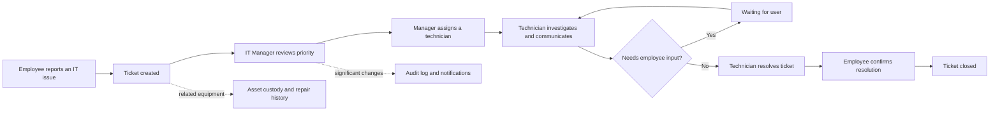

<div align="center">

# OpsFlow

### Internal IT Service Desk and Asset Operations Platform

OpsFlow brings support tickets, technician workflows, company assets, notifications, role-based access, and audit history into one accountable workspace.

[](https://laravel.com/)
[](https://react.dev/)
[](https://www.typescriptlang.org/)
[](https://www.postgresql.org/)
[](https://www.docker.com/)
[](#project-status)

**Portfolio project · Production-oriented engineering · Local demo available**

</div>

---

## About the project

OpsFlow is a full-stack portfolio project that simulates how an internal IT department receives employee issues, coordinates technicians, tracks company equipment, and preserves an auditable operational history.

The project is intentionally more than a CRUD showcase. It demonstrates business workflow design, backend-enforced authorization, transaction-safe state changes, private attachments, database notifications, audit logging, automated tests, Dockerized infrastructure, and a responsive role-aware interface.

> **Ringkasan:** OpsFlow adalah aplikasi helpdesk dan manajemen aset internal. Pegawai membuat ticket, IT Manager melakukan triage dan assignment, teknisi menangani pekerjaan, lalu seluruh komunikasi dan perubahan status tercatat sampai ticket ditutup.

## Table of contents

- [Business workflow](#business-workflow)
- [Core capabilities](#core-capabilities)
- [Roles and access](#roles-and-access)
- [Architecture](#architecture)
- [Engineering highlights](#engineering-highlights)
- [Technology stack](#technology-stack)
- [Quick start](#quick-start)
- [Demo accounts](#demo-accounts)
- [Quality checks](#quality-checks)
- [Project structure](#project-structure)
- [Documentation](#documentation)
- [Deployment](#deployment)
- [Project status](#project-status)

## Business workflow



The controlled status lifecycle is:

```text
OPEN → ASSIGNED → IN_PROGRESS ↔ WAITING_USER → RESOLVED → CLOSED
  └──────────────────────→ CANCELLED
```

Important transitions are validated by the backend. A reporter can confirm a resolved ticket, while technicians and managers operate only within their authorized scope.

## Core capabilities

### Service desk

- Ticket creation with category, priority, description, optional asset, and attachments.
- Search and filters by workflow state and priority.
- Technician assignment and controlled state transitions.
- Public conversation between employees and IT staff.
- IT-only internal notes hidden from employees.
- Immutable activity timeline showing assignment, priority, and status events.
- Private randomized attachment storage and authorized downloads.

### Asset custody

- Company asset inventory with generated asset codes.
- Assignment and return workflows executed inside database transactions.
- Current custodian, assignment history, and return history.
- Repair and support tickets linked to each asset.
- Employee-scoped **My Assets** view and company-wide IT inventory view.

### Identity and governance

- Laravel Sanctum session authentication with CSRF protection.
- Login throttling, inactive-account protection, and password reset flow.
- Granular RBAC with multi-role user assignment.
- Editable permission matrix for non-administrator roles.
- Administrator role protected from accidental permission restriction.
- User administration, departments, and ticket categories.
- Database-backed notifications with unread state and deep links.
- Audit records containing actor, action, entity, IP address, and timestamp.

### User experience

- Responsive React interface for desktop and mobile.
- Role-aware navigation and protected frontend routes.
- Global `⌘K` / `Ctrl K` command palette.
- Interactive dashboards, workflow feedback, semantic status badges, and empty states.
- Reduced-motion and touch-device fallbacks.
- Route-level lazy loading for smaller initial JavaScript delivery.

## Roles and access

OpsFlow ships with four default roles. Access is enforced again on the Laravel backend through Policies, Gates, and Form Requests—the interface is not treated as the security boundary.

| Capability | Employee | IT Technician | IT Manager | Administrator |
|---|:---:|:---:|:---:|:---:|
| View dashboard | Personal scope | Assigned and unassigned work | All operations | All operations |
| Create ticket | Yes | No by default | Yes | Yes |
| View tickets | Own | Assigned + unassigned | All | All |
| Update workflow | Confirm own resolution | Assigned tickets | All tickets | All tickets |
| Public comments | Yes | Yes | Yes | Yes |
| Internal IT notes | No | Yes | Yes | Yes |
| View assets | Own | All | All | All |
| Create/assign/return assets | No | No | Yes | Yes |
| View users | No | No | Read-only | Yes |
| Manage users and roles | No | No | No | Yes |
| View audit logs | No | No | Yes | Yes |
| Manage ticket categories | No | No | Yes | Yes |
| Manage departments | No | No | No | Yes |
| Configure role permissions | No | No | No | Yes |

Users may receive multiple roles. Their effective access is the union of permissions granted by those roles.

## Architecture

OpsFlow is implemented as a modular monolith with a separate React SPA and Laravel JSON API.

```text
Browser
  │ same-origin HTTP + Sanctum cookies
  ▼
Nginx :8080
  ├── /                       → React + Vite SPA
  ├── /sanctum/*, /api/v1/*   → Laravel PHP-FPM
  │                                ├── PostgreSQL
  │                                └── Redis
  └── background services          ├── queue worker
                                   └── scheduler
```

The main backend request flow is:

```text
Route
  → Form Request validation
  → Policy / Gate authorization
  → Thin Controller
  → Explicit Action or Query
  → Eloquent Model + database transaction
  → API Resource serialization
```

Laravel-native patterns are preferred. The project does not introduce a Repository layer for every model without a concrete need.

## Engineering highlights

- Thin controllers with explicit and testable business Actions.
- Policies and Gates as the backend authorization boundary.
- Form Requests for validation and authorization entry points.
- API Resources for predictable JSON serialization.
- Transactions and row locking for multi-step operational workflows.
- Reusable visibility queries for role-scoped tickets and assets.
- Audit logging for security-sensitive and operational changes.
- Idempotent seeders with realistic portfolio data.
- Separate development and immutable production Docker images.
- Health checks for web, backend, PostgreSQL, Redis, and frontend services.
- CI pipeline for PHP formatting, backend tests, frontend lint/build, and production-image builds.
- No committed secrets; real environment files are ignored by Git.

## Technology stack

| Layer | Technology |
|---|---|
| Frontend | React 19, TypeScript 6, Vite 8, React Router, TanStack Query, Lucide icons |
| Backend | PHP 8.4, Laravel 13, Laravel Sanctum |
| Database | PostgreSQL 16 |
| Cache and queue | Redis 7 |
| Web runtime | Nginx, PHP-FPM |
| Infrastructure | Docker, Docker Compose |
| Quality | PHPUnit 12, Laravel Pint, Oxlint, TypeScript compiler |
| Automation | GitHub Actions |

## Quick start

### Prerequisites

Only the following host tools are required:

- Docker Desktop with Docker Compose v2
- Git
- `make` (optional; equivalent Docker commands are also documented)

PHP, Composer, Node.js, PostgreSQL, Redis, and Nginx do not need to be installed directly on the host.

### Installation

```bash
git clone <repository-url> opsflow
cd opsflow

cp .env.example .env
cp backend/.env.example backend/.env

make setup
docker compose exec backend php artisan db:seed
```

Open [http://localhost:8080](http://localhost:8080).

`make setup` builds the images, installs backend dependencies, creates the Laravel application key, starts the stack, and runs database migrations. It does not delete existing Docker volumes.

### Daily commands

```bash
make up             # Start existing services
make ps             # Show containers and health status
make logs           # Follow service logs
make test           # Run backend tests
make lint           # Lint and build the frontend
make down           # Stop containers while preserving data
```

Useful direct commands:

```bash
docker compose exec backend php artisan migrate
docker compose exec backend php artisan db:seed
docker compose exec frontend npm run lint
docker compose exec frontend npm run build
```

> Do not run `docker compose down -v` unless deleting the local PostgreSQL and Redis volumes is intentional.

For a beginner-friendly explanation of every Docker concept and command, read [docs/DOCKER_SETUP_GUIDE.md](docs/DOCKER_SETUP_GUIDE.md).

## Demo accounts

All local demo accounts use the password `password`.

| Role | Email | Suggested review |
|---|---|---|
| Administrator | `admin@opsflow.local` | Users, Access Control, Audit Logs, Master Data |
| IT Manager | `manager@opsflow.local` | Operations dashboard, assignment, asset custody |
| IT Technician | `technician@opsflow.local` | Assigned work, status flow, internal notes |
| Employee | `employee@opsflow.local` | Personal tickets, comments, My Assets |

The idempotent development seed contains:

- 4 roles and 23 granular permissions
- 5 departments and 9 ticket categories
- 10 users
- 20 assets
- 30 realistic tickets

These credentials and records are development-only. Never run demo seeders in a real production environment.

## Environment configuration

The root `.env` controls Docker Compose ports and PostgreSQL bootstrap credentials. `backend/.env` controls Laravel.

Important variables include:

```text
APP_ENV, APP_KEY, APP_DEBUG, APP_URL
DB_HOST, DB_PORT, DB_DATABASE, DB_USERNAME, DB_PASSWORD
REDIS_HOST, REDIS_PORT
SESSION_DRIVER, CACHE_STORE, QUEUE_CONNECTION
SANCTUM_STATEFUL_DOMAINS, SESSION_DOMAIN
MAIL_MAILER
```

Real environment files are excluded from Git. Commit only `.env.example` templates.

## Quality checks

Run the complete local verification set with:

```bash
docker compose exec backend vendor/bin/pint --test
make test
docker compose exec frontend npm run lint
docker compose exec frontend npm run build
docker compose ps
```

Latest verified project state:

| Check | Result |
|---|---|
| Backend tests | **29 passed, 184 assertions** |
| MVP acceptance scenarios | **3 passed** |
| Frontend TypeScript production build | **Passed** |
| Oxlint | **Passed** |
| Browser console audit | **No application errors** |
| Docker services | **Healthy / running** |

The acceptance suite covers the complete ticket lifecycle, asset assignment/return history, and unauthorized administration access.

## Continuous integration

Every push to `main` or `develop`, and every pull request, runs GitHub Actions jobs for:

1. Composer dependency installation.
2. Laravel Pint formatting verification.
3. Backend tests against PostgreSQL 16.
4. Frontend dependency installation, Oxlint, and production build.
5. Production backend and web Docker image builds.

The workflow is defined in [.github/workflows/ci.yml](.github/workflows/ci.yml).

## Project structure

```text
opsflow/
├── backend/                       Laravel API and business domain
│   ├── app/Actions/               Transactional business workflows
│   ├── app/Http/Controllers/      Thin HTTP controllers
│   ├── app/Http/Requests/         Validation and request authorization
│   ├── app/Http/Resources/        API response serialization
│   ├── app/Policies/              Model authorization rules
│   ├── app/Queries/               Role-scoped data visibility
│   ├── database/migrations/       PostgreSQL schema
│   ├── database/seeders/          Idempotent demo data
│   └── tests/                     Unit, feature, authorization, acceptance
├── frontend/                      React + TypeScript SPA
│   └── src/
│       ├── auth/                  Sanctum session state
│       ├── components/            Shared UI and protected routes
│       ├── lib/                   API client and utilities
│       ├── pages/                 Route-level application screens
│       └── types/                 API TypeScript contracts
├── docker/                        Development and production images
├── docs/                          API, Docker, deployment, reviews
├── .github/workflows/ci.yml       Automated verification pipeline
├── compose.yaml                   Development stack
├── compose.production.yaml        Production-style stack
├── PRD_OpsFlow.md                 Product source of truth
└── PROGRESS.md                    Resumable implementation history
```

## API and documentation

The JSON API is versioned under `/api/v1`.

| Document | Purpose |
|---|---|
| [PRD_OpsFlow.md](PRD_OpsFlow.md) | Product requirements and business source of truth |
| [docs/API.md](docs/API.md) | Authentication, endpoints, payloads, filters, and responses |
| [docs/DOCKER_SETUP_GUIDE.md](docs/DOCKER_SETUP_GUIDE.md) | Beginner-friendly Docker guide from first principles |
| [docs/DEPLOYMENT.md](docs/DEPLOYMENT.md) | Production deployment and rollback checklist |
| [docs/ENGINEERING_REVIEW.md](docs/ENGINEERING_REVIEW.md) | Security, performance, logging, and monitoring review |
| [PROGRESS.md](PROGRESS.md) | Current implementation and verification status |

## Security controls

- Sanctum authentication and server-side session invalidation.
- CSRF protection for state-changing browser requests.
- Generic login and password-reset responses to limit account enumeration.
- Login and password-reset throttling.
- Backend authorization on every protected business operation.
- Inactive users rejected before accessing application data.
- Internal notes removed from employee-facing API responses.
- Private attachment storage with randomized filenames and authorized downloads.
- Validated file type and size constraints.
- Administrator permissions protected from accidental restriction.
- Audit entries for important identity and workflow changes.
- Production templates disable debug mode and avoid hard-coded secrets.

## Deployment

The repository includes a production-style Docker Compose configuration with immutable application images, Redis-backed infrastructure, health checks, background worker, and scheduler.

Read [docs/DEPLOYMENT.md](docs/DEPLOYMENT.md) before publishing the application.

Minimum production-style sequence:

```bash
cp .env.production.example .env.production

docker compose --env-file .env.production -f compose.production.yaml build
docker compose --env-file .env.production -f compose.production.yaml up -d postgres redis
docker compose --env-file .env.production -f compose.production.yaml run --rm backend php artisan migrate --force
docker compose --env-file .env.production -f compose.production.yaml up -d
```

A real public environment should additionally use managed secrets, TLS, database backups, persistent object storage, an external mail provider, centralized logs, and uptime/error monitoring.

## Project status

The PRD MVP is implemented and verified locally.

- [x] Authentication and account recovery
- [x] Granular RBAC and multi-role accounts
- [x] Complete ticket workflow
- [x] Comments, internal notes, activity, and attachments
- [x] Asset inventory, assignment, return, and history
- [x] Notifications and audit logs
- [x] User, role, category, and department administration
- [x] Responsive role-aware frontend
- [x] Docker development and production stacks
- [x] Automated tests and CI pipeline
- [ ] Public portfolio deployment
- [ ] Curated repository screenshots

Future scope intentionally left outside the MVP includes SLA automation, reporting/export, knowledge base, SSO, real-time WebSocket notifications, and AI-assisted categorization.

## Portfolio note

This repository is an educational portfolio project designed to demonstrate production-oriented software-engineering practices. Demo identities and records are fictional and must not be used as real organizational data.
